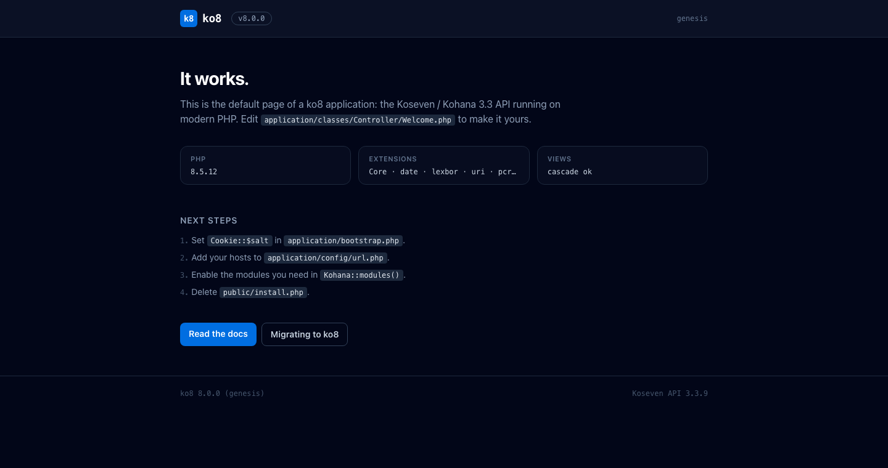
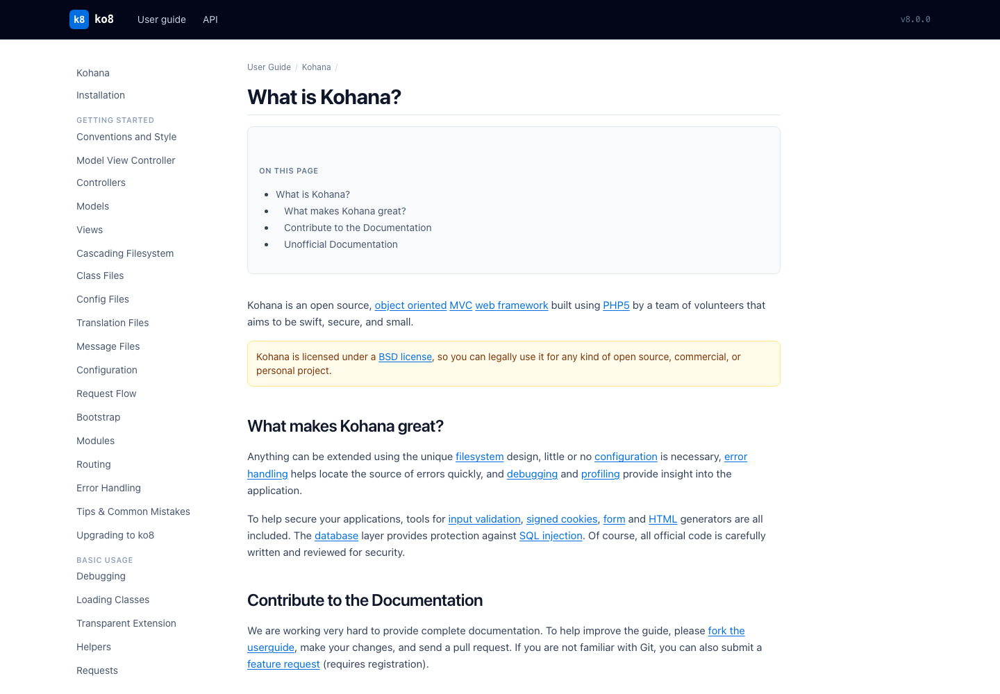
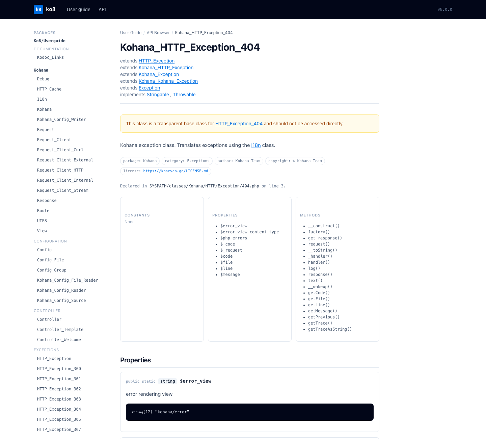
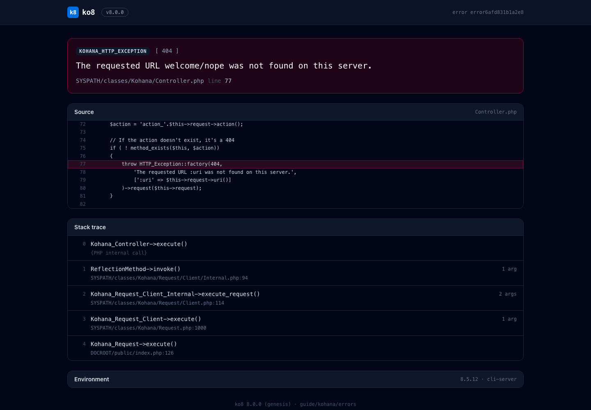
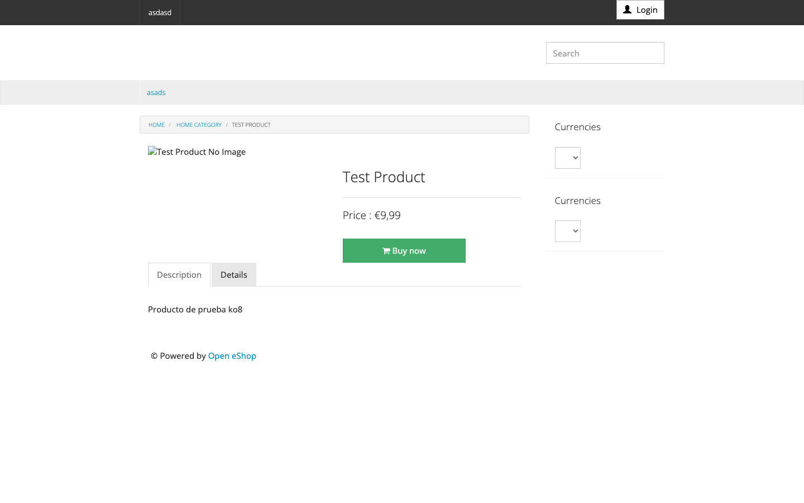
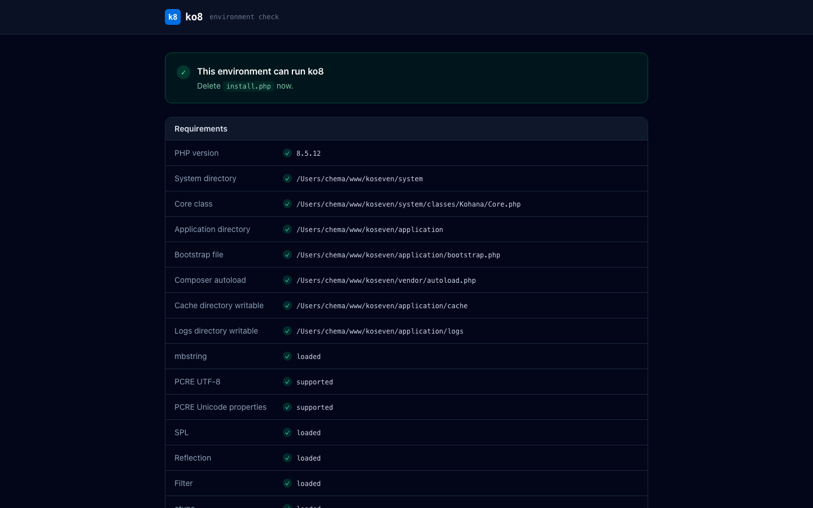

# ko8

**The Koseven / Kohana 3.3 API on modern PHP.** Lightweight HMVC, cascading filesystem, zero magic. No DI container, no annotations, no 40-package dependency tree.

```bash
git clone --branch v8.0.0 --depth 1 https://github.com/neo22s/ko8.git myapp
cd myapp && composer install
```

Requires PHP 8.1+. Runs on 8.1, 8.2, 8.3, 8.4 and 8.5.



## Read this first: maintenance

**ko8 is not maintained.** I built it out of curiosity — to see whether a framework
from 2010 could still run on a PHP from 2026, and whether an AI could do the
tedious part without breaking it. It works, it is tested, and I am not using it
in production, so I am not going to maintain it.

That is not a trap, it is a handover. The licence is BSD-3-Clause: **fork it,
rename it, publish it, sell support for it.** You do not need my permission and
you do not need to ask. If you want to be the person who maintains it, be that
person — the repository is a complete, working starting point, not a demo.

What you get if you take it:

- A framework that boots clean on PHP 8.5 with zero deprecations.
- 1,484 tests (43 new, 1,441 inherited from Kohana and Koseven).
- A working guide and API browser, 106 pages and 173 classes, with a link
  checker that fails the build on a broken one.
- A migration tool that reads an application and tells you what will break.

## Why

Kohana was a good framework with a bad ending. It was small, it had a real
cascading filesystem, and it did not pretend that a web app needed an
application container to render a form. Then PHP moved on, the maintainers moved
on, and in 2014 Kohana announced its final releases.

Koseven picked it up for the PHP 7 era and kept it alive until it was archived
in April 2026. For anyone still running a Kohana or Koseven application, that
leaves the same problem Koseven solved in 2017, a few PHP versions later: the
code works, the server does not.

There are two honest options. Rewrite the application, which for a ten-year-old
codebase means rewriting the business logic too, not just the framework. Or take
the framework forward one more time.

ko8 is the second option, done once, with the result left on the table.

## What it is

The whole point is that **nothing about the API changes**.

`Model_*`, `Controller_*`, `Route::set()`, `ORM::factory()`, `Kohana::$config`,
the cascading filesystem and the transparent class extension all behave exactly
as they did in Koseven 3.3.9. You replace `system/` and `modules/`, keep
`application/`, and fix the handful of places where PHP 8 changed behaviour.

| | Kohana | Koseven | ko8 |
|---|---|---|---|
| Latest release | 3.3.6 | 3.3.10 | **8.0.0** `genesis` |
| PHP | 5.3 – 7.0 | 7.0 – 8.0 | **8.1 – 8.5** |
| `Kohana::VERSION` | `3.3.6` | `3.3.9` | `8.0.0` |
| `Kohana::KOSEVEN_COMPAT` | — | — | `3.3.9` |

The version number changed because the code did. `3.3.9` means "Koseven 3.3.9";
two codebases answering with the same string is a support problem. Code that
needs to know which API it is running against compares `Kohana::KOSEVEN_COMPAT`,
never `VERSION`.

## What changed

Where PHP 8 made the old code fatal or wrong:

| Issue | Where |
|---|---|
| `array_key_exists()` on a `Config_Group` threw `TypeError` | `Arr::path()` |
| `mysqli` throws `mysqli_sql_exception` since 8.1, driver expected `FALSE` | `Database_MySQLi::connect()` |
| 90 implicitly nullable parameters (deprecated in 8.4) | whole codebase |
| `ReturnTypeWillChange` notices on 4 classes | `Validation`, `HTTP_Header`, `Config_Group`, `Database_Result` |
| `E_STRICT` removed in 8.4 | `Kohana_Exception::$php_errors` |
| `strftime()`, `utf8_decode()`, `each()` | `Date`, `UTF8`, codebase |
| `rawurlencode(NULL)` deprecated | `Route::uri()` |
| ORM models implementing `Serializable`, deprecated in 8.1 | `ORM::__serialize()` / `__unserialize()` |
| `encrypt` defaulting to mcrypt, a fatal at config load | `modules/encrypt/config/encrypt.php` |
| `curl_close()`, deprecated in 8.5 | `Request_Client_Curl` |

And where the framework's own UI was showing its age: the error page, installer,
profiler, pagination and codebench are all Tailwind now. So are the guide and
the API browser.







## Migrating

Two commands tell you almost everything.

```bash
php bin/ko8-doctor.php application
```

```
ko8 doctor · 939 files scanned

WILL BREAK (1)
  oc/common/classes/oc/i18n.php:449
    money_format() was removed in PHP 8.0.
    fix: NumberFormatter::formatCurrency()

PROBABLY BREAKS (13)
  oc/classes/model/affiliate.php:113
    `Model_Product $product = NULL` relies on an implicit nullable, deprecated in PHP 8.4.
    fix: Write `?Model_Product $product = NULL`.

Summary: 1 will break, 13 probably break, 139 to check.
```

Exit `0` clean, `1` something will break, `2` only warnings. `--json` for CI.
The scan is token based, so `$this->money_format()` (your method) is not confused
with `money_format()` (the built-in PHP 8 removed), and `$('.x').each(` inside a
template string is not a call.

Then download the release and copy the framework over:

```bash
git clone --branch v8.0.0 --depth 1 https://github.com/neo22s/ko8.git ko8
cp -R ko8/system .
cp -R ko8/modules .
```

Keep `application/` untouched. That is the point.

The full guide, with every fix spelled out, is [docs/migration.md](docs/migration.md),
and the same content is served by the framework itself at
`/guide/kohana/upgrading-from-kohana`.

## Tested on a real application

Not on a hello-world. On [open eShop](https://github.com/open-classifieds/open-eshop),
a classifieds and e-commerce platform that started life on Kohana 3.3 and has
been in production since 2013. It is the reason Koseven existed in the first
place: I built Koseven to keep it running.

The migration was: copy `system/` and `modules/`, run the doctor, fix one
`money_format()` call and one implicit nullable.

```
$ diff -rq application/kohana/system system
(no differences)

$ curl -s -o /dev/null -w '%{http_code}' https://openeshop.test/
200

Pages checked: home, listing, product, search, login, register, contact, RSS,
sitemap, panel. No fatals, no deprecations, empty error log.
```



That is the acceptance test that matters: a 13-year-old codebase, unmodified
apart from two lines, on PHP 8.5.

## Tests

```bash
composer test          # ko8 suite                         43 tests
composer test:legacy   # inherited Kohana/Koseven suite  1441 tests
composer smoke         # boot, route, render: 12 checks on your PHP version
composer check:guide   # every guide and docblock link
composer doctor        # scan application/ for PHP 8 breakage
```

The inherited suite is not rewritten by hand; `tools/import-legacy-tests.php`
mechanically ports the 2016 tests to PHPUnit 11 and documents every deviation.
See [docs/testing.md](docs/testing.md).

CI is `.github/workflows/tests.yml`: the smoke test on PHP 8.1 – 8.5, the suites
on 8.2 – 8.5 (PHPUnit 11 requires 8.2, so 8.1 gets a real check instead of a
silent skip).

## Layout

```
application/    your code: controllers, models, views, config
modules/        optional components (database, orm, auth, cache, image, minion…)
system/         the framework
  classes/      Kohana_* implementation + transparent extension shims
public/         document root (index.php, install.php)
tests/          PHPUnit 11 suite
tools/          smoke test, guide link checker, docs crawler, legacy importer
bin/            ko8-doctor.php
assets/         Tailwind source
```

## Quick start

1. `composer install` (optional; only the test suite needs it)
2. Point your web server at `public/`
3. Open `/install.php` and fix whatever it reports
4. Set `Cookie::$salt` in `application/bootstrap.php`
5. Delete `install.php`



## Documentation

Every module keeps its Markdown under `guide/`. With the `userguide` module
enabled in development:

- `/guide` — index of documented modules
- `/guide/kohana/install` — installation guide
- `/guide/kohana/upgrading-from-kohana` — the road from Kohana to Koseven to ko8
- `/guide-api` — reflection-based API browser

`/guide/install` redirects to the core guide page, because that is the URL people
remember.

## Assets

The compiled CSS is committed, so production does not need Node:

```bash
npm install
npm run build
```

## If you want to take this over

Take it. Really.

- Fork it, rename it, publish your own package name. The `Kohana_*` classes must
  stay `Kohana_*` — that is what `Kohana::auto_load()` looks for — but the
  project name is yours.
- Do not rename classes. Renaming `Kohana_*` to `Ko8_*` breaks every application
  for no functional gain. It is the one thing that would make this work useless.
- Never add a parameter to an overridable method. `URL::site()` gained
  `$subdomain` in Koseven and that single change was the most common fatal when
  migrating a real application.
- [ROADMAP.md](ROADMAP.md) has the security work I would do first: `SameSite`
  cookies, refusing to unserialize unencrypted session payloads, and
  `password_hash()` in `Auth`. None of it needs an API change.
- [CONTRIBUTING.md](CONTRIBUTING.md) has the five commands to run before a commit.

If nobody picks it up, the code is here, it is tested, and it works. That is a
better ending than a dead repository.

## Licence

BSD-3-Clause. See [LICENSE](LICENSE). The inherited Kohana (2007–2017 Kohana
Team) and Koseven (2016 Koseven Team) notices are preserved verbatim in
[LICENSE.legacy.md](LICENSE.legacy.md).
