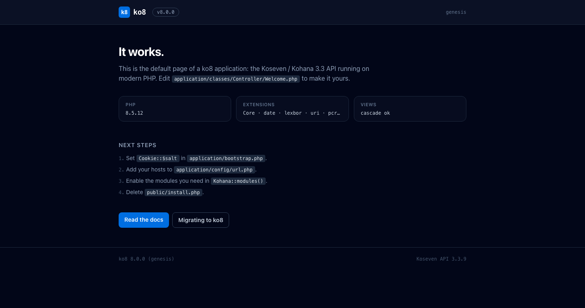
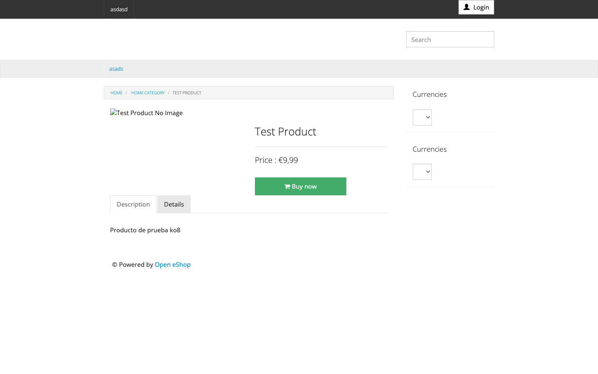
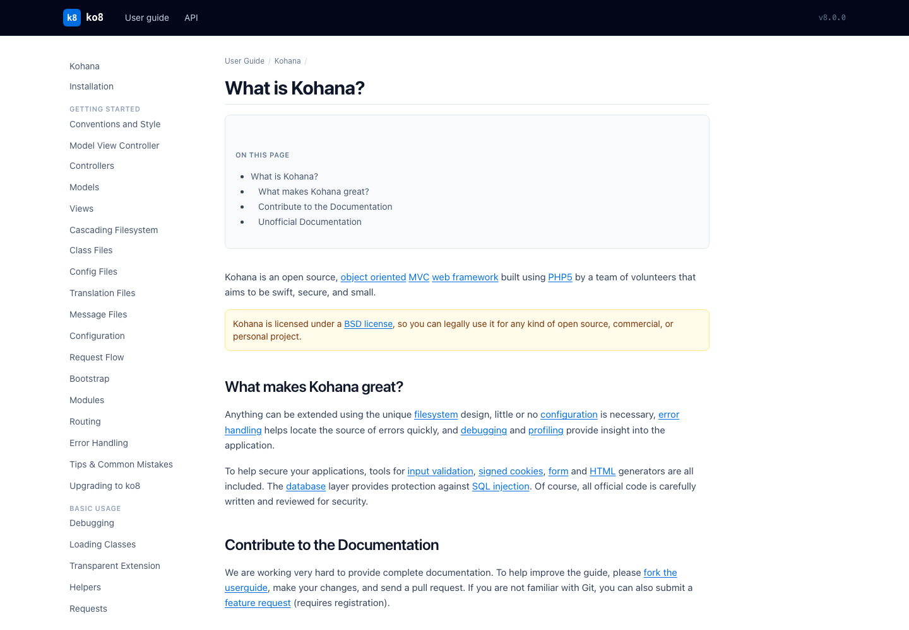
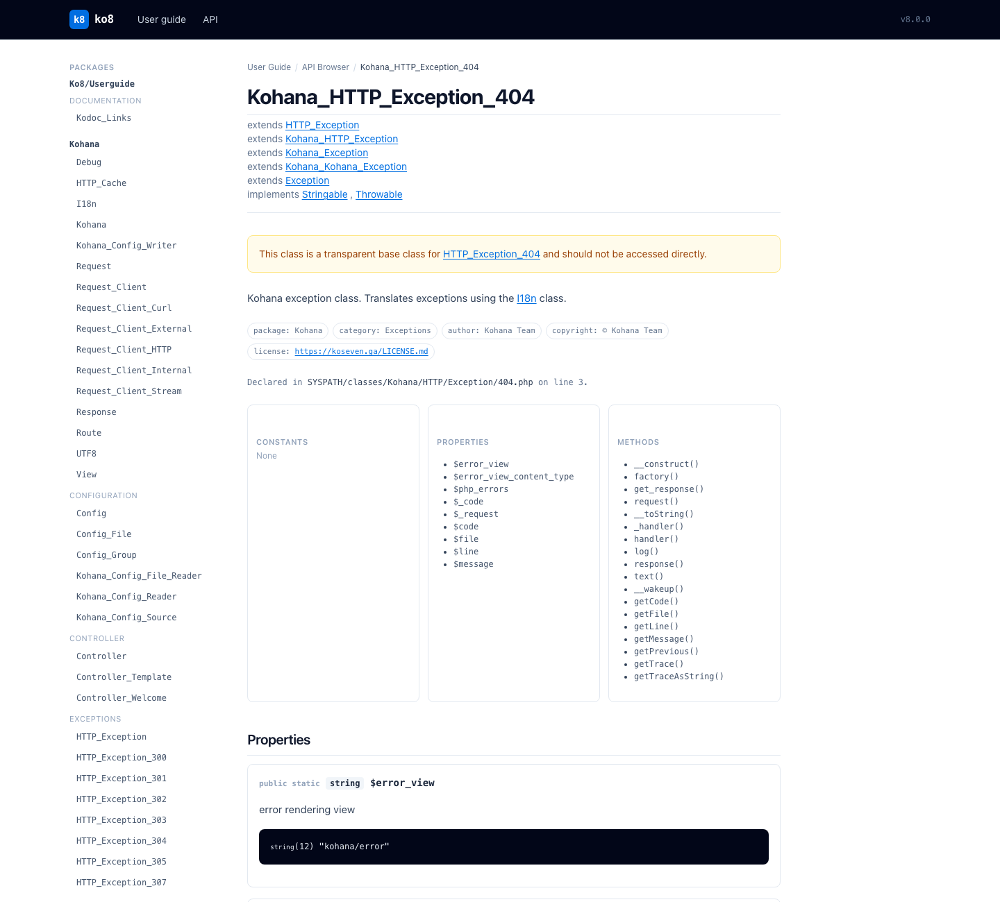
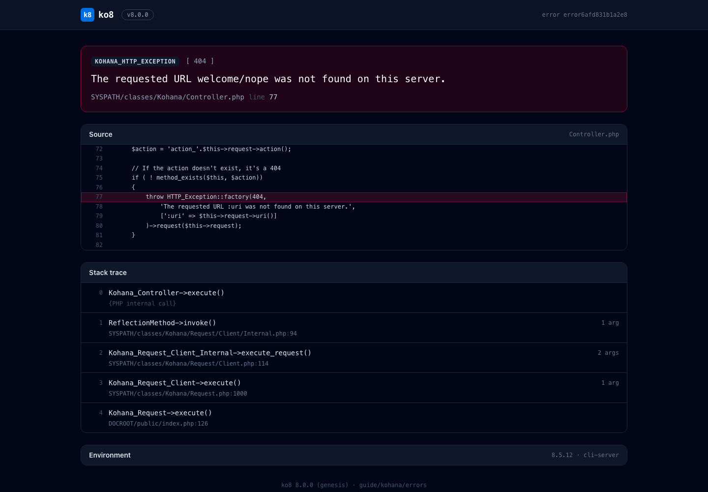

# Kohana is dead, long live ko8

*A framework from 2010, sixteen years later, on a PHP it was never meant to see — and an honest note about who is going to maintain it. Nobody. It might be you.*

---

In 2008 I was on the Kohana team. Kohana was a PHP framework with a simple idea that turned out to be right: keep the framework out of the way. No configuration files to memorise, no code generation, no application container. A cascading filesystem, so that overriding anything — a class, a config file, a view, a translation — meant dropping a file in the right folder. It was small enough to read in an afternoon and it did not treat you like a beginner.

It was also good. For a while, very good: fast, clean, and used by a lot of production applications, mine among them.

Then PHP moved on and the team moved on, which is how open source usually ends. On 1 July 2017 Kohana was officially retired. By then a few of us had already done the obvious thing: fork it and take it to PHP 7. That fork was Koseven — tagged **ko7**, Kohana for PHP 7 — and it exists because of exactly one application: **open eShop**, a classifieds and e-commerce platform I have been shipping since 2013. Rewriting it was never an option. Rewriting the framework underneath it was an afternoon.

Koseven held for eight years. Then, in April 2026, it was archived too: *"docs: project archived — thank you everyone"*.

That leaves every Kohana and Koseven application in the same place Koseven was in 2016, one PHP version later. PHP 8 removed `mcrypt`, removed `each()`, removed `money_format()`, turned `count(null)` into an exception and `array_key_exists()` on an object into a `TypeError`. The application still works. The platform underneath it does not.

So: **ko8**. Kohana, for PHP 8.



## What it is, and what it is not

ko8 is not a rewrite, a modernisation, or a framework inspired by Kohana. It is the Koseven 3.3.9 API with the PHP 8 problems fixed, and nothing else.

`Model_*`, `Controller_*`, `Route::set()`, `ORM::factory()`, `Kohana::$config`, the cascading filesystem, transparent class extension — all unchanged. If you know Kohana, you know ko8. You migrate by replacing `system/` and `modules/`, keeping `application/`, and fixing the handful of places where PHP 8 changed behaviour. For most applications that is under ten files, and I have a tool that tells you which ones.

| | Kohana | Koseven | ko8 |
|---|---|---|---|
| Last release | 3.3.6 (2016) | 3.3.10 (2020) | **8.0.0** `genesis` |
| PHP | 5.3 – 7.0 | 7.0 – 8.0 | **8.1 – 8.5** |
| `Kohana::VERSION` | `3.3.6` | `3.3.9` | `8.0.0` |

The version number changed because the code did. Two codebases answering `3.3.9` is a support problem, so ko8 says `8.0.0` and keeps a `Kohana::KOSEVEN_COMPAT = '3.3.9'` constant for code that needs to know which API it is running against.

## The migration tool

The first thing I built was not the framework. It was the thing that tells you whether you need the framework.

`bin/ko8-doctor.php` reads an application *without executing it* and reports what will break, with the file, the line, and the fix:

```
$ php bin/ko8-doctor.php application
ko8 doctor · 939 files scanned

WILL BREAK (1)
  oc/common/classes/oc/i18n.php:449
    money_format() was removed in PHP 8.0.
    fix: NumberFormatter::formatCurrency()

PROBABLY BREAKS (13)
  oc/classes/model/affiliate.php:113
    `Model_Product $product = NULL` relies on an implicit nullable, deprecated in PHP 8.4.
    fix: Write `?Model_Product $product = NULL`.

Summary: 1 will break, 13 probably break, 139 to check.
```

The scan is token based, not regex based, and that is the whole point. `$this->money_format()` is your method, not the built-in PHP removed. `function money_format()` is a declaration, not a call. `$('.x').each(` inside a JavaScript template string is not `each()`. A regex flags all three; the tokenizer flags none.

Getting this wrong is not a cosmetic issue. My first version flagged 147 things in open eShop, and 146 of them were noise. A report you ignore is worse than no report.

## Tested on a real application, not a hello-world

This is the part that matters, so here is the honest version.

The acceptance test was **open eShop**: a classifieds platform that started on Kohana 3.3, has been in production since 2013, and is the reason Koseven exists in the first place. Its `oc/kohana/system` was Koseven 3.3.9.

The migration was:

1. Copy ko8's `system/` and `modules/` over the Koseven ones.
2. Run the doctor.
3. Fix one `money_format()` call in `oc/common/classes/oc/i18n.php` and one implicit nullable.
4. Reload.

```
$ diff -rq oc/kohana/system system
(no differences)
```

Home, listing, product page, search, login, register, contact, RSS, sitemap, admin panel: HTTP 200, no fatals, no deprecations, empty error log. On PHP 8.5.



Thirteen years of classifieds platform. Two lines of application code.

## The framework's own face was the worst part

Kohana's error page and installer were 2010 HTML. If the first thing a developer sees is a broken-looking framework, they assume the framework is broken. So every piece of HTML the framework serves itself is Tailwind now: the error page, the installer, the profiler, the pagination views, codebench, and the documentation engine.

The guide and the API browser are the ones I actually care about, because they are the difference between a dead repository and a usable one. 106 guide pages, 173 API classes, every link resolved to an absolute path, and two tools that fail if one is broken:

```
$ php tools/check-guide-links.php
guide pages: 106
broken targets: 0

$ php tools/crawl-docs.php https://koseven.test /index.php/guide
pages checked: 401
broken: 0
```





The error page is the one I am happiest with, because it is the page that appears when everything else is wrong, and it has to work when nothing else does. It inlines its own CSS, so it renders even if your document root or rewrite rules are the problem.



## The tests

I did not rewrite 1,441 inherited tests by hand. I wrote a script that mechanically ports them to PHPUnit 11 and documents every deviation, because a test suite that is rewritten by hand is a test suite where someone quietly deletes the tests that were inconvenient.

```
composer test          43 tests, 500 assertions
composer test:legacy   1441 tests, 3030 assertions
composer smoke         12 checks, boot + route + render + encrypt
composer check:guide   106 pages, 0 broken links
```

CI runs on PHP 8.1 through 8.5 for the smoke test and 8.2 through 8.5 for the suites, because PHPUnit 11 requires 8.2 — and 8.1 gets a real check instead of a silent skip.

## The part where I am honest about the AI

I did this because of a question I could not answer from memory: **can a framework from 2010 still run on a PHP from 2026?** Not "would it be nice if", but actually run, on a real application, with tests passing.

And a second question, which is the real reason this exists: **can an AI do the tedious part of that without breaking it?**

The answer to both is yes, with a caveat that matters.

The AI is very good at the mechanical part. Ninety implicitly nullable parameters, `E_STRICT` removed, `strftime()` gone, `utf8_decode()` deprecated, `mysqli` throwing exceptions where the driver expected `FALSE`, `Serializable` deprecated in ORM models — that is a long, boring, error-prone list, and it is exactly the kind of work a machine does better than I do at 1am.

It is also confidently wrong in ways that look right. The first version of the doctor *looked* fine and silently missed three of its five rules, because it compared token constants to strings. A whole rewrite of the guide's link resolution was correct in my head and broke forty links in practice, because I had guessed the guide's convention instead of reading it. The CI went red on the first push for a reason that does not reproduce on macOS. None of that was caught by the AI knowing more; it was caught by running things.

The lesson is not "AI wrote my framework". It is that the bottleneck moved. Writing 18,000 lines of compatible PHP is no longer the expensive part. Knowing which 18,000 lines to check, and refusing to believe a green test that tests the wrong thing, still is.

## It is not maintained. Take it.

Here is the part most project READMEs bury, and I would rather put it at the front.

**I am not going to maintain ko8.** I am not running it in production. open eShop works on it, but open eShop is not my product any more. I built ko8 because I wanted to know whether it could be done, and now I know.

That is not a warning, it is a handover. The licence is BSD-3-Clause. **Fork it, rename it, publish it, sell support for it.** You do not need my permission.

If you take it, three rules keep it useful:

1. **Never rename `Kohana_*`.** That prefix is what `Kohana::auto_load()` looks for. Renaming it breaks every application for no functional gain. It is the one thing that would make this work worthless.
2. **Never add a parameter to an overridable method.** Koseven added `$subdomain` to `URL::site()` and that single change was the most common fatal when migrating a real application. Once was enough.
3. **Keep the tests.** All 1,484 of them. They are the reason this is a framework and not a demo.

`ROADMAP.md` has the security work I would do first if it were mine: `SameSite` cookies, refusing to unserialize unencrypted session payloads, and `password_hash()` in `Auth`. None of it needs an API change.

If nobody picks it up, the code is here, it is tested, and it works. That is a better ending than a dead repository.

---

**Repository:** [github.com/neo22s/ko8](https://github.com/neo22s/ko8)
**Release:** [ko8 8.0.0 (genesis)](https://github.com/neo22s/ko8/releases/tag/v8.0.0)
**Migration guide:** [docs/migration.md](https://github.com/neo22s/ko8/blob/ko8/docs/migration.md)

*Kohana 3.3.6 — 2016. Koseven 3.3.10 — 2020. ko8 8.0.0 — 2026. Some of us are slow learners.*
